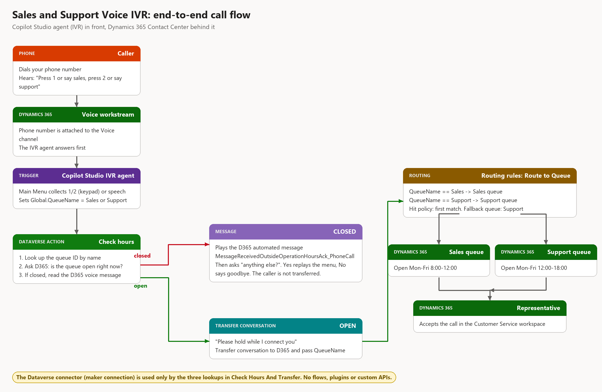

# Sales and Support Voice IVR for Dynamics 365 Contact Center

A ready-to-install **Copilot Studio voice IVR** for **Dynamics 365 Contact Center** that:

- answers a call and offers **"press 1 or say sales"** and **"press 2 or say support"**
- checks the **operating hours of the chosen queue** before it transfers anything
- if the queue is **open**, transfers the call to Dynamics 365 and routes it to the right queue (**Sales** or **Support**)
- if the queue is **closed**, plays the **out-of-operating-hours voice message configured in Dynamics 365**, then **asks if there is anything else it can help with**: "yes" goes back to the menu, "no" says goodbye and ends the call. Nobody is transferred to an empty queue and the call is never dropped right after the message

It uses only built-in pieces: no Power Automate flows, no plugins, no custom APIs, no Azure resources.



## What is in the box

| Part | What it is | Where |
|---|---|---|
| **Copilot Studio agent** `Sales and Support IVR` | The IVR: menu, hours check, transfer. Packaged as a Dataverse solution. | [`solution/`](solution) (and in the [Release](../../releases)) |
| **D365 setup script** | Creates operating hours, the Sales and Support queues, a voice workstream, the routing rules, and attaches the agent. | [`scripts/Install-D365Setup.ps1`](scripts/Install-D365Setup.ps1) |
| **Test script** | Simulates a call as a text chat so you can test without a phone. | [`scripts/Test-IvrConversation.ps1`](scripts/Test-IvrConversation.ps1) |
| **Topic source** | The agent's topics as readable YAML, for reference and code review. | [`agent-source/`](agent-source) |
| **Documentation** | How every node works, install, manual Dynamics 365 setup, configuration, troubleshooting. | [`docs/`](docs) |

## Quick start

1. **Download** `SalesSupportVoiceIVR_unmanaged.zip` (or `_managed.zip`) from the [latest Release](../../releases/latest).
2. **Import** it into your environment (make.powerapps.com > Solutions > Import) and pick a **Microsoft Dataverse** connection when asked.
3. **Publish** the agent in Copilot Studio.
4. **Run** the D365 setup script:
   ```powershell
   az login
   ./scripts/Install-D365Setup.ps1 -EnvironmentUrl https://<yourorg>.crm.dynamics.com -TimeZoneCode 35
   ```
5. **Attach your phone number** to the Voice channel of `Voice IVR Workstream` in Copilot Service admin center.
6. **Add representatives** to the Sales and Support queues.
7. **Call** the number.

Full steps, prerequisites and the time zone table are in [docs/INSTALL.md](docs/INSTALL.md).

## How it works, in one minute

1. The caller dials the number. The voice workstream hands the call to the **IVR agent first**.
2. **Main Menu** asks the question and accepts keypad **1/2** or the spoken words **sales/support**. It stores the choice in `Global.QueueName`.
3. **Check Hours And Transfer** looks up the queue by name, then asks Dynamics 365 (built-in action `msdyn_ExpandOperatingHoursForEntityCollection`) whether that queue has an available slot in the next minute.
4. **Closed**: it reads the voice message `MessageReceivedOutsideOperationHoursAck_PhoneCall` from Dynamics 365 and says it. It then asks **"Is there anything else I can help you with?"** (press 1 or say yes, press 2 or say no). **Yes** replays the menu so the caller can pick the other queue; **No** says goodbye and ends the call.
5. **Open**: it says "Please hold" and runs **Transfer conversation**, which hands the call to Dynamics 365 and passes `QueueName`.
6. In Dynamics 365 the **Route to Queue** ruleset reads `QueueName` and puts the call in the Sales or Support queue.

[docs/HOW-IT-WORKS.md](docs/HOW-IT-WORKS.md) explains **every node and every Dynamics 365 setting**, with screenshots of each.

## What was tested

| Check | Result |
|---|---|
| Real phone calls with keypad (DTMF) into the IVR, hours check, handoff to Dynamics 365 | Verified in the author's environment |
| Simulated chat: Sales closed -> message played -> "anything else?" -> No -> goodbye and end | Verified |
| Simulated chat: Sales closed -> message -> "anything else?" -> Yes -> menu replayed -> Sales -> message -> No -> end | Verified |
| Simulated chat: Support open -> handoff event with `QueueName=Support` | Verified |
| Invalid answer -> menu replayed | Verified |
| Clean install into a **second** environment (import solution, bind connection, publish, run setup script) | Verified on v1.0.0: import succeeded, agent published, script completed, both paths tested. v1.0.1 changes only the closed-branch topic and was tested in the author's environment. |
| Managed solution import | Exported and inspected; the unmanaged package is the one used in the install test |

## Known limitations

- **The phone number is not created** by the package. Add yours to the workstream's Voice channel.
- **Operating hours are per queue, but the closed message is shared.** The out-of-hours voice message is a single Dynamics 365 automated message used by both queues. See [docs/CONFIGURATION.md](docs/CONFIGURATION.md) to change the wording or to give each queue its own message.
- **Queue names are matched by name.** The agent looks up queues called exactly `Sales` and `Support`. If you rename them, update the agent too (see configuration).
- **The Dataverse connection is the maker's.** Callers are never asked to sign in. The connection owner's account runs the lookups, so use a service account in production.
- **Days and time zone** are chosen when you run the setup script (default Monday to Friday). Holidays are managed in the operating hours calendar.
- The agent uses **classic orchestration** with a closed-list menu on purpose: a deterministic menu is faster and more predictable on a phone than a generative one.

## Repository layout

```
.
├── README.md
├── LICENSE
├── solution/                        Solution zips (also attached to each Release)
├── scripts/
│   ├── Install-D365Setup.ps1        Dynamics 365 side
│   └── Test-IvrConversation.ps1     Text-chat call simulator
├── agent-source/                    Topics as YAML (reference)
└── docs/
    ├── HOW-IT-WORKS.md              Node-by-node explanation with screenshots
    ├── INSTALL.md
    ├── MANUAL-D365-SETUP.md         Click-by-click Dynamics 365 setup (no script)
    ├── CONFIGURATION.md
    ├── TROUBLESHOOTING.md
    ├── images/
    └── tools/make_diagrams.py       Regenerates the diagrams
```

## License

[MIT](LICENSE). Provided as a sample, without warranty. Test in a non-production environment first.
