# How it works, node by node

This page explains every topic, every node, and every Dynamics 365 setting in the solution. Read it top to bottom once, then use it as a reference when you customize.

- [1. The big picture](#1-the-big-picture)
- [2. Key concepts used by the agent](#2-key-concepts-used-by-the-agent)
- [3. Topic: Conversation Start](#3-topic-conversation-start)
- [4. Topic: Main Menu](#4-topic-main-menu)
- [5. Topic: Check Hours And Transfer](#5-topic-check-hours-and-transfer)
- [6. Supporting voice topics](#6-supporting-voice-topics)
- [7. The Dynamics 365 side](#7-the-dynamics-365-side)
- [8. Why it is built this way](#8-why-it-is-built-this-way)

---

## 1. The big picture


Two systems work together:

| System | Job |
|---|---|
| **Copilot Studio agent** (the IVR) | Talks to the caller, collects the choice, decides **open or closed**, and either ends the call with the closed message or transfers it. |
| **Dynamics 365 Contact Center** | Owns the phone number, the queues, the operating hours, and the representatives. After the transfer it **routes the call to the right queue**. |

The agent answers first (**bot-first**). A human is involved only when the chosen queue is open.

---

## 2. Key concepts used by the agent

You will see these in every screenshot.

| Concept | Meaning here |
|---|---|
| **Topic** | A conversation flow made of nodes. This agent has three main ones (Conversation Start, Main Menu, Check Hours And Transfer) plus voice system topics. |
| **Node** | One step in a topic: a message, a question, a condition, a variable assignment, a connector action, and so on. |
| **Trigger** | What starts a topic. *On conversation start* fires when the call is answered. *Recognized intent* with no phrases means "only start me when another topic sends the caller here". |
| **Global variable** (`Global.X`) | Lives for the whole call and can be seen by every topic. It is also what gets sent to Dynamics 365 on transfer. |
| **Topic variable** (`Topic.X`) | Lives only inside one topic. |
| **Speech and DTMF** | Every message and question has a *speech* version (spoken to the caller) and can listen for **DTMF** (keypad tones) as well as spoken words. |
| **Maker connection** | The Dataverse connection runs as the person who set it up, so the caller never has to sign in. |

### Variables used

| Variable | Scope | Set by | Used for |
|---|---|---|---|
| `Global.QueueName` | Global | Main Menu | The queue the caller chose (`Sales` or `Support`). **Sent to Dynamics 365** and used by the routing rules. |
| `Global.QueueId` | Global | Check Hours And Transfer | The Dataverse ID of that queue, found by name. |
| `Topic.MenuChoice` | Main Menu | The question | The option the caller picked. |
| `Topic.QueueClosed` | Check Hours | Check Hours | `true` when the queue has no available slot right now. |
| `Topic.HoursResponse`, `Topic.QueueLookup`, `Topic.OohResponse`, `Topic.OohMessage` | Check Hours | Dataverse actions | Raw results and the message text. |
| `Topic.AnythingElse` | Check Hours | The follow-up question | Yes (back to the menu) or No (goodbye). |

---

## 3. Topic: Conversation Start

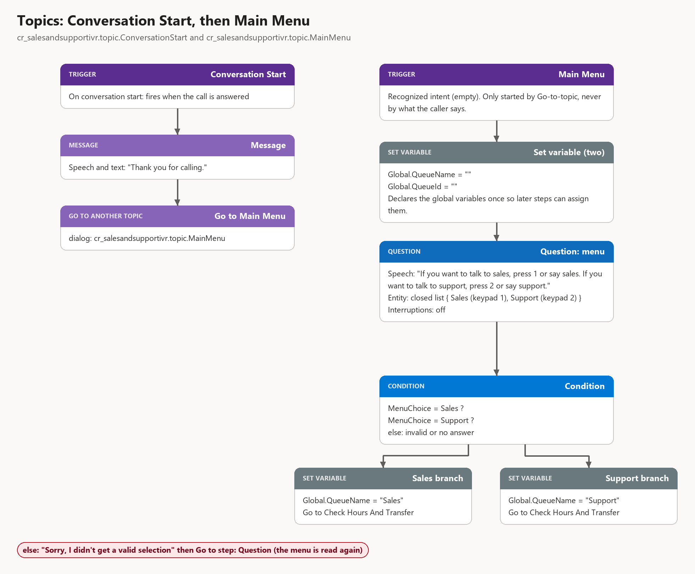

`cr_salesandsupportivr.topic.ConversationStart`

| # | Node | What it does |
|---|---|---|
| 1 | **Trigger: On conversation start** | Fires the moment the call is answered. |
| 2 | **Message** | Says "Thank you for calling." The same sentence is used as the on-screen text and the spoken text. |
| 3 | **Go to another topic: Main Menu** | Hands over to the menu. It is a separate topic so the **Escalate** topic can reuse it. |

---

## 4. Topic: Main Menu

`cr_salesandsupportivr.topic.MainMenu`

Real screenshots of the topic in the Copilot Studio designer:

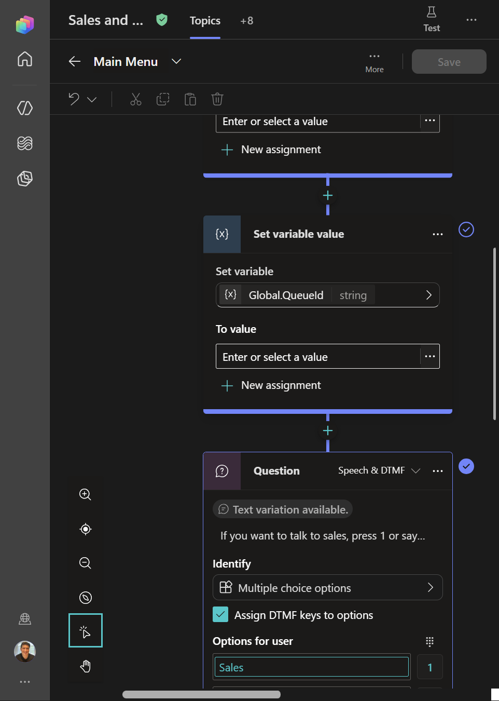

**Trigger (Recognized intent, empty).** The designer shows "The agent chooses" because the topic has no trigger phrases. That is intentional: nothing the caller says can start this topic. Only a **Go to another topic** node can.

**Set variable x2.** `Global.QueueName = ""` and `Global.QueueId = ""`. This declares the two global variables once. Later steps only assign them. (Declaring a global in two different branches of the same topic is not allowed, which is why it is done up front.)

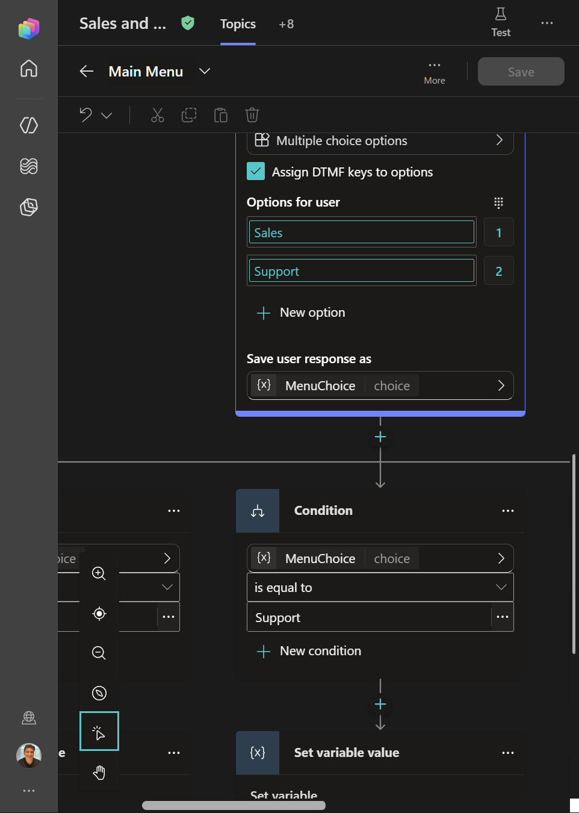

**Question node (the menu).** The important settings:

| Setting | Value | Why |
|---|---|---|
| Message | *"If you want to talk to sales, press 1 or say sales. If you want to talk to support, press 2 or say support."* | Exactly the two options requested. |
| Identify | **Multiple choice options** | A **closed list** entity: only `Sales` and `Support` are valid, so speech recognition is constrained and fast. |
| **Assign DTMF keys to options** | Sales = **1**, Support = **2** | Lets the caller press the key instead of speaking. |
| Save user response as | `MenuChoice` | The chosen option. |
| Allow interruption | **Off** | Words like "hello" cannot jump out to another topic in the middle of the menu. |

**Condition node.** Branches on `MenuChoice`: *is equal to Sales*, *is equal to Support*, and **All other conditions**. The else branch says "Sorry, I didn't get a valid selection" and uses **Go to step** to play the question again, so a caller who says something unexpected hears the menu again instead of silence.

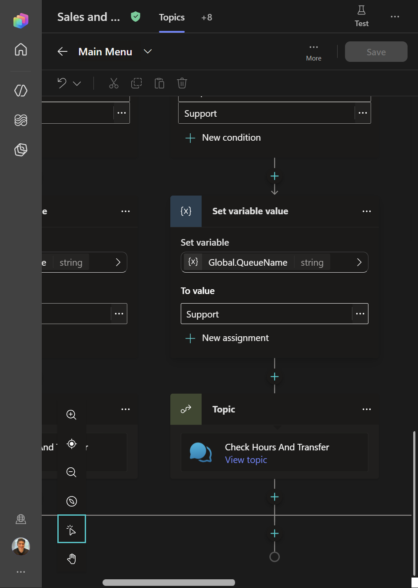

**Branch: Set variable + Go to another topic.** Each branch sets `Global.QueueName` to the literal `Sales` or `Support` and then goes to **Check Hours And Transfer**. This literal is the only place the queue names are written in the agent (see [CONFIGURATION.md](CONFIGURATION.md)).

---

## 5. Topic: Check Hours And Transfer

`cr_salesandsupportivr.topic.CheckHoursAndTransfer`: the heart of the solution.

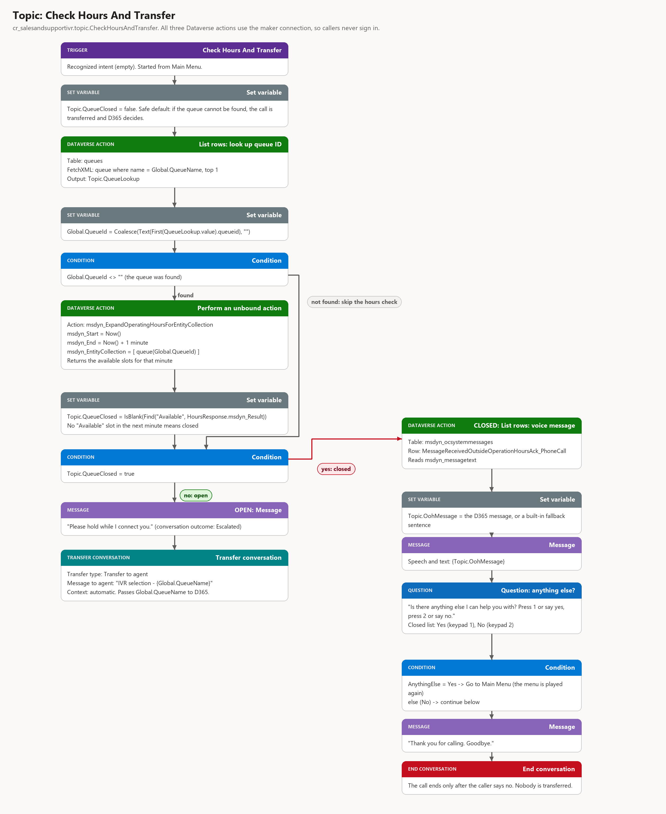

### 5.1 Safe default

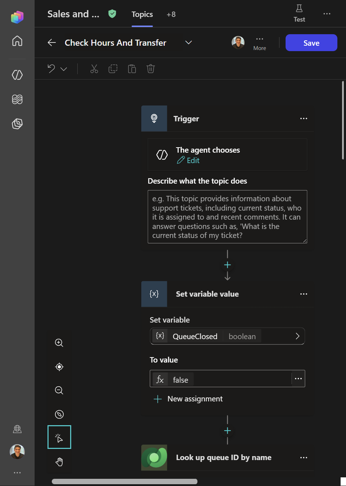

`Topic.QueueClosed = false`. If anything stops us from checking (for example the queue is not found), the call is treated as **open** and transferred. Dynamics 365 then makes the final decision, so a caller is never stuck.

### 5.2 Look up the queue by name

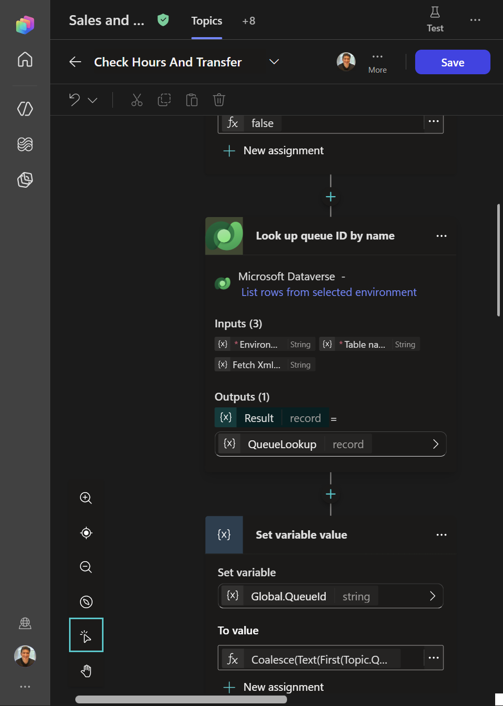

A **Dataverse > List rows from selected environment** node.

| Input | Value |
|---|---|
| Table name | `queues` |
| Fetch Xml | a query for the **queue whose name equals `Global.QueueName`**, top 1 |

The result is `Topic.QueueLookup`. A **Set variable** then copies the ID into `Global.QueueId`:

```
Global.QueueId = Coalesce(Text(First(Topic.QueueLookup.value).queueid), "")
```

*Why look up by name?* Queue IDs are different in every environment. Looking them up by name makes the same agent work in any environment with no editing.

### 5.3 Was the queue found?

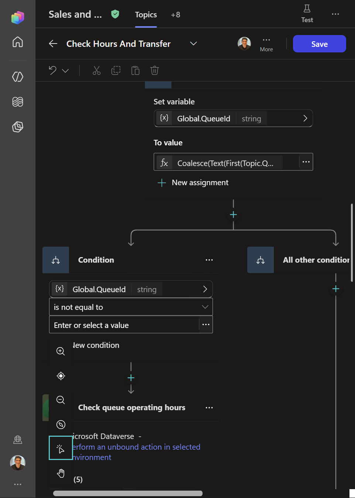

**Condition:** `Global.QueueId` *is not equal to* `""`.

- **Yes** (found): continue to the hours check.
- **No** (not found): skip it and go straight to the transfer decision with `QueueClosed = false`.

### 5.4 Ask Dynamics 365 whether the queue is open

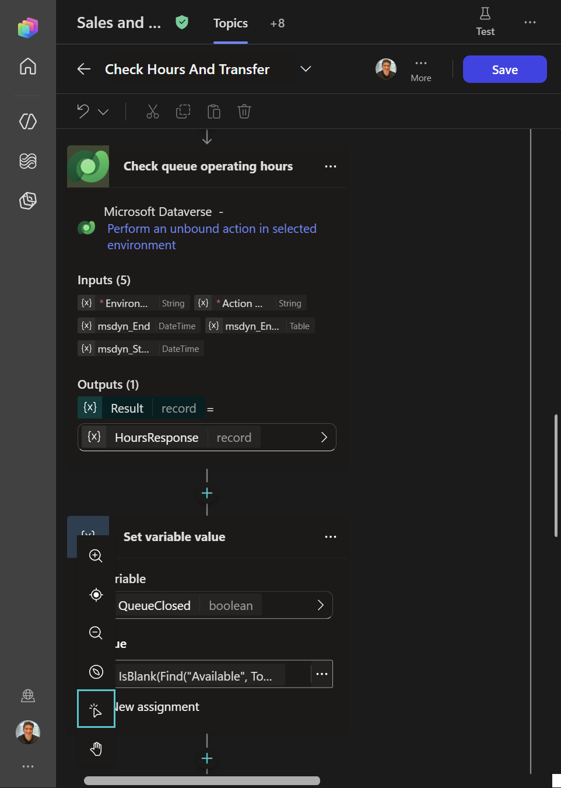

A **Dataverse > Perform an unbound action in selected environment** node calling the built-in action **`msdyn_ExpandOperatingHoursForEntityCollection`**. This is the same engine Dynamics 365 itself uses to expand operating hours. It needs no custom code.

| Input | Value | Meaning |
|---|---|---|
| Action name | `msdyn_ExpandOperatingHoursForEntityCollection` | Built into Dynamics 365. |
| `msdyn_Start` | `Now()` | Window start: this moment. |
| `msdyn_End` | `Now() + 1 minute` | Window end. |
| `msdyn_EntityCollection` | a one-item table with the queue ID | Which queue to evaluate. |

The result is a JSON string. For an **open** queue it contains the schedulable slot:

```json
{"queue#<id>": {"CalendarSlots": {"2026-10-22T00:00:00Z": [
  {"Start":"2026-10-22T16:00:00Z","End":"2026-10-22T22:00:00Z","TimeCode":"Available"}]}}}
```

For a **closed** queue, `CalendarSlots` is empty (`{}`). Holidays and daylight saving time are handled by Dynamics 365, not by the agent.

Next, a **Set variable** decides:

```
Topic.QueueClosed = IsBlank(Find("Available", Topic.HoursResponse.msdyn_Result))
```

No `"Available"` slot in the next minute means the queue is closed.

### 5.5 Closed or open?

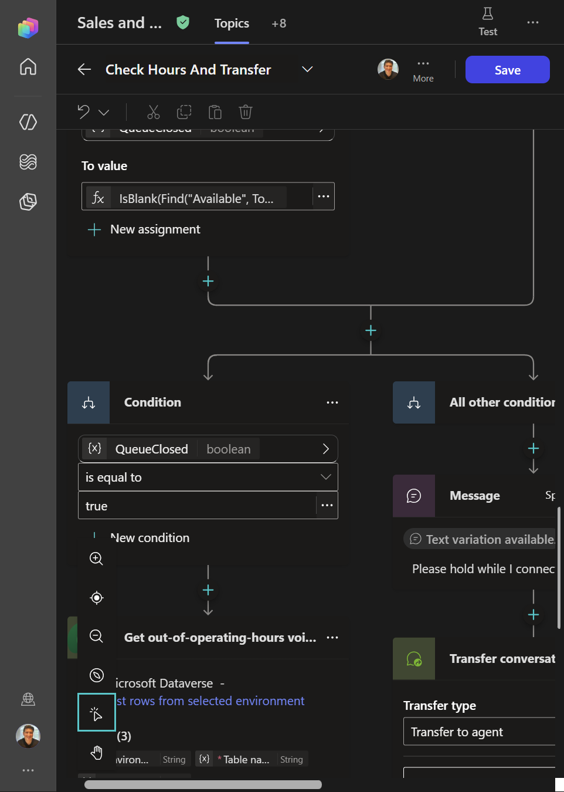

**Condition:** `Topic.QueueClosed` *is equal to* `true`. (A formula-style condition would also work at run time, but the designer only displays conditions of the form *variable, operator, value*, so this one is written that way.)

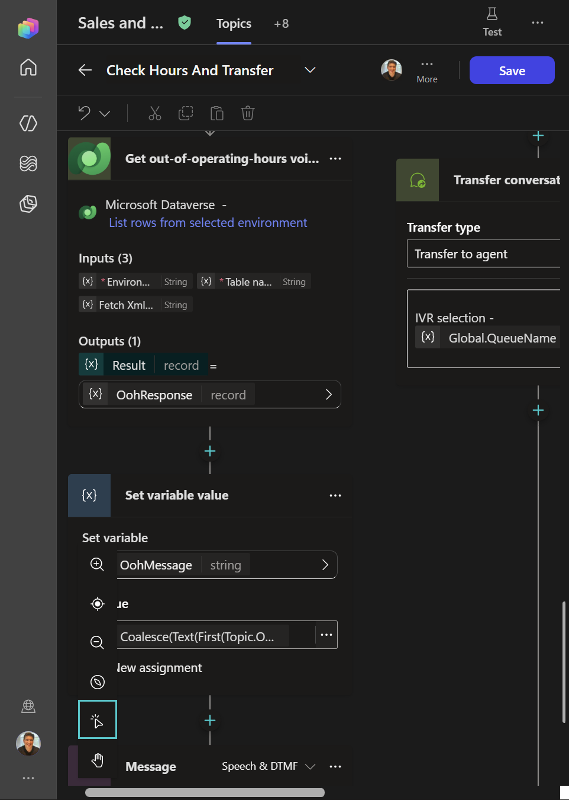

#### Closed branch

1. **List rows** from table `msdyn_ocsystemmessages` for the row named **`MessageReceivedOutsideOperationHoursAck_PhoneCall`**. This is the **voice automated message configured in Dynamics 365**. It is read live on every call, so changing it in Dynamics 365 changes what callers hear with no agent change and no republish.
2. **Set variable** `Topic.OohMessage` = that message, or a built-in fallback sentence if none is found.
3. **Message** that speaks `{Topic.OohMessage}`.

   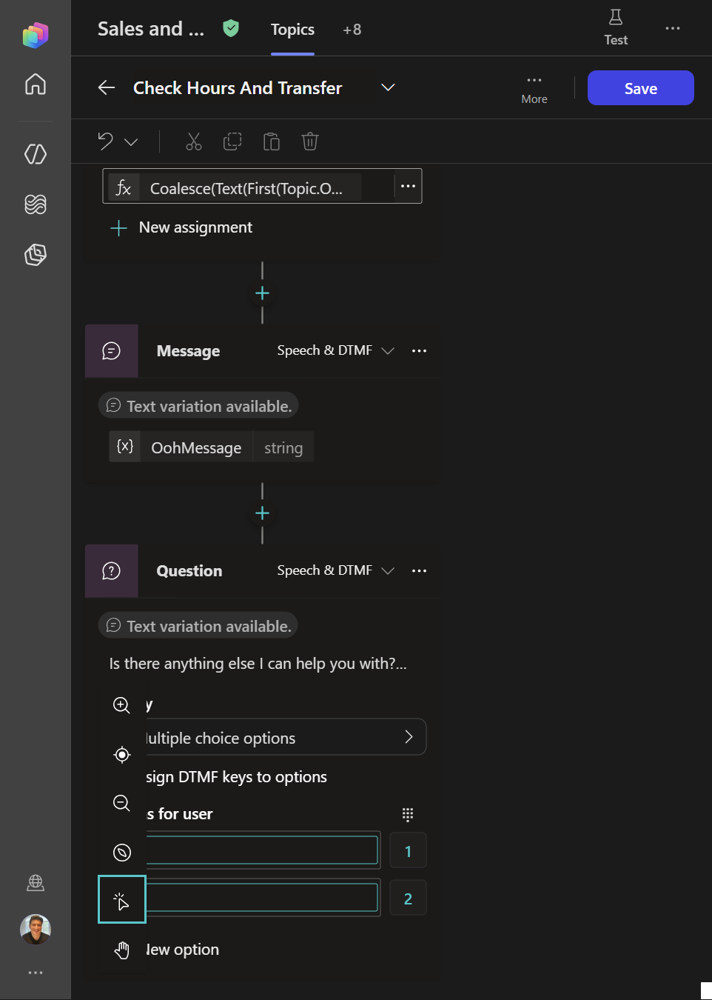

4. **Question: "Is there anything else I can help you with?"** The call is **not dropped** after the message. This is a closed-list question (Yes = keypad 1, No = keypad 2) with interruptions off, saved to `Topic.AnythingElse`.

   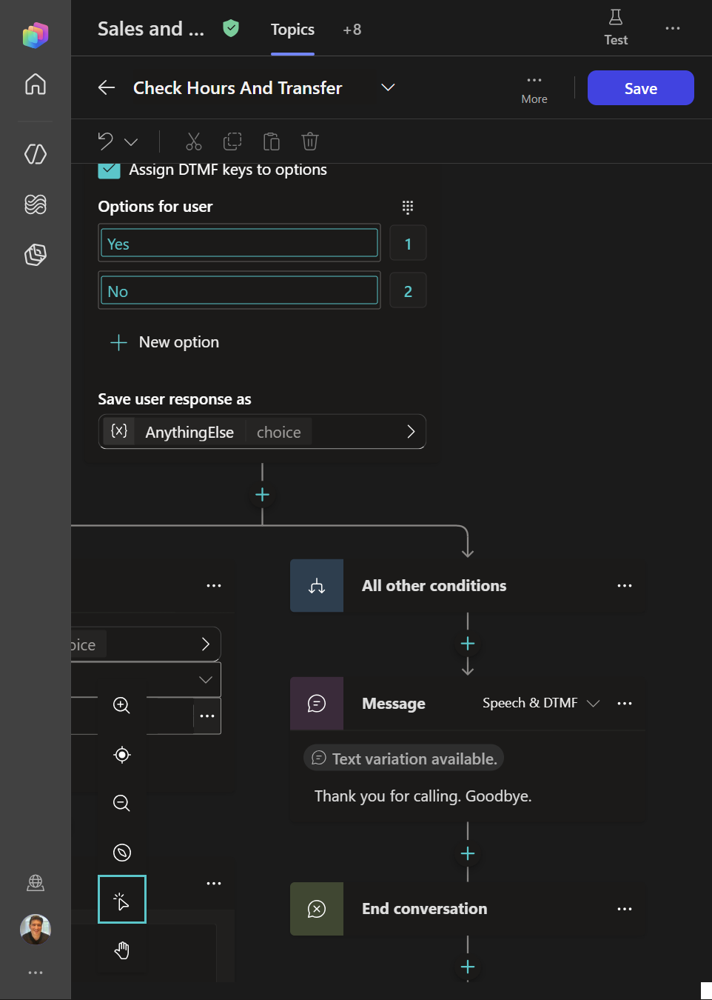

5. **Condition** on `AnythingElse`:
   - **Yes**: **Go to another topic: Main Menu**. The menu is played again, so the caller can try the other queue (which may be open) or the same one.
   - **All other conditions** (No): a **Message** "Thank you for calling. Goodbye." and then **End conversation**.

   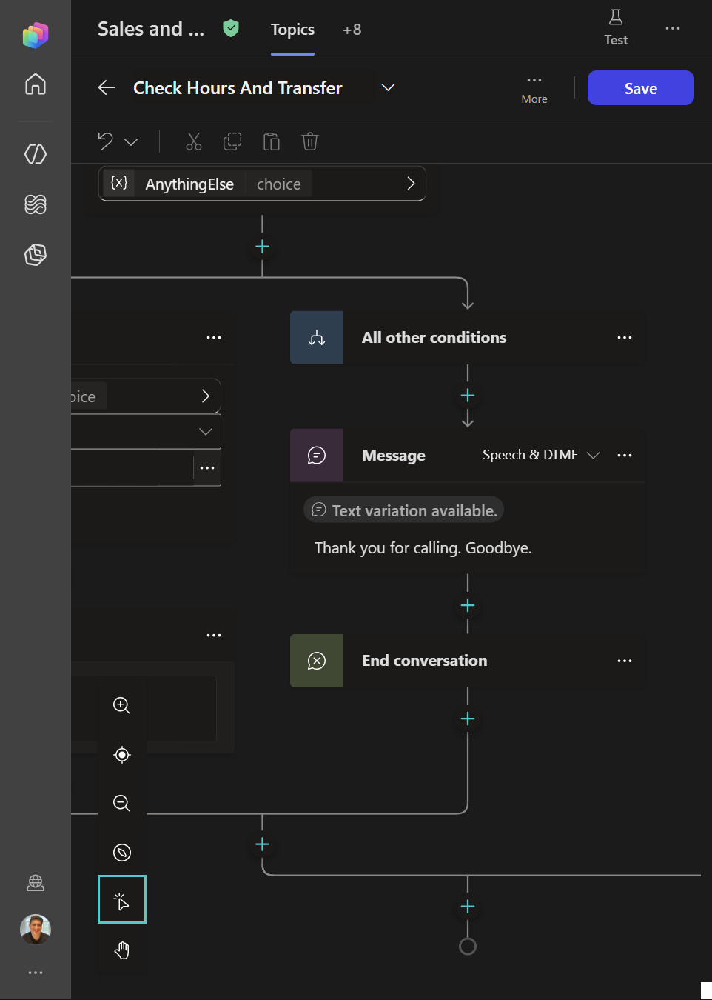

   Silence is handled by the **Silence detection** topic, and an unrecognized answer is re-asked by the question itself, so the call only ends when the caller says no (or stays silent).

**Nobody is transferred** on the closed branch.

#### Open branch (All other conditions)

1. **Message** "Please hold while I connect you." with conversation outcome **Escalated**.
2. **Transfer conversation**:

| Setting | Value |
|---|---|
| Transfer type | **Transfer to agent** (the Dynamics 365 representative path) |
| Message to agent | `IVR selection - {Global.QueueName}`: shown to the representative |
| Context | **Automatic**: passes the conversation's variables, including **`Global.QueueName`**, to Dynamics 365 |

This is the moment the call leaves the IVR. The value `QueueName` travels with it and the routing rules in Dynamics 365 use it (section 7.4).

---

## 6. Supporting voice topics

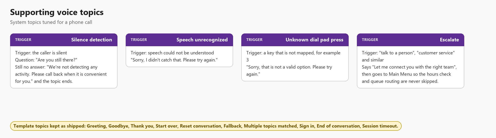

| Topic | Trigger | Behavior |
|---|---|---|
| **Silence detection** | The caller is silent | Asks "Are you still there?". If there is still no answer, says to call back and ends the topic. |
| **Speech unrecognized** | Speech could not be understood | "Sorry, I didn't catch that. Please try again." |
| **Unknown dial pad press** | A keypad key that is not mapped (for example 3) | "Sorry, that is not a valid option. Please try again." |
| **Escalate** | "talk to a person", "customer service", and similar phrases | Says "Let me connect you with the right team" and **goes to Main Menu**. It deliberately does **not** transfer directly, so the hours check and queue routing can never be bypassed. |

The standard template topics (Greeting, Goodbye, Thank you, Start over, Reset conversation, Fallback, Multiple topics matched, Sign in, End of conversation, Session timeout) are kept as shipped.

**Agent-level settings** (set in the solution): voice enabled with the **Telephony** channel and the **Dynamics 365 Contact Center (Omnichannel)** channel; **classic orchestration** (no generative answers); authentication left as the template default because callers are identified by phone, not by sign-in.

---

## 7. The Dynamics 365 side

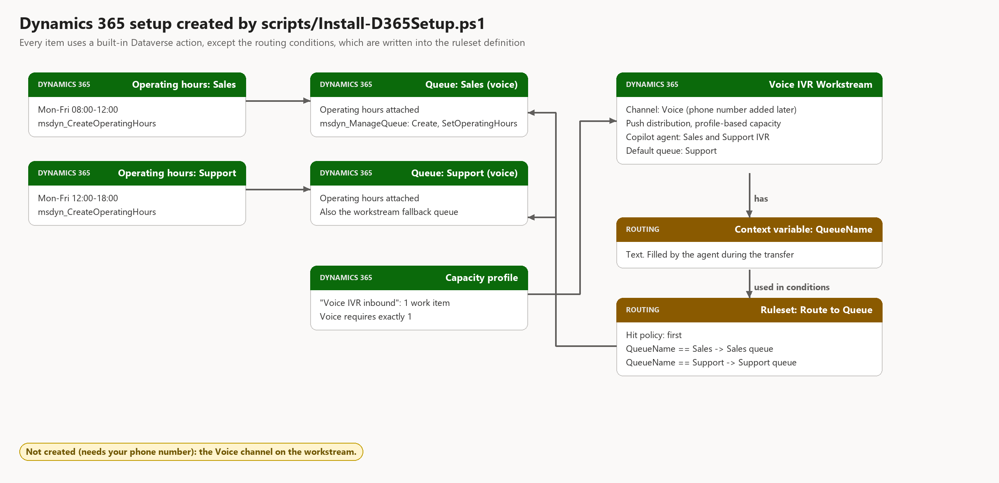

[`scripts/Install-D365Setup.ps1`](../scripts/Install-D365Setup.ps1) creates all of this. Every item uses a built-in Dataverse action except the routing conditions (7.4).

### 7.1 Operating hours and queues

| Item | Setting | Built-in action |
|---|---|---|
| Operating hours "Sales" | Mon-Fri 08:00-12:00 in your time zone | `msdyn_CreateOperatingHours` |
| Operating hours "Support" | Mon-Fri 12:00-18:00 | `msdyn_CreateOperatingHours` |
| Queue **Sales** | Voice queue, Sales hours attached | `msdyn_ManageQueue` (Create, SetOperatingHours) |
| Queue **Support** | Voice queue, Support hours attached | `msdyn_ManageQueue` |

The script also gives each queue an assignment contract, priority 1 and the private view, matching what the admin center creates for a voice queue.

### 7.2 Capacity profile (voice needs exactly one call)

Dynamics 365 requires that a **voice** workstream uses a capacity profile with a **work item limit of exactly 1** (an agent handles one call at a time). The script creates **Voice IVR inbound** (1 unit). If you see *"Voice workstreams require a capacity profile with work item limit set to exactly 1"* when saving the Work distribution panel, your selected profile has a different limit. See [TROUBLESHOOTING.md](TROUBLESHOOTING.md).

### 7.3 The voice workstream


| Setting | Value |
|---|---|
| Channel | **Voice** (you add the phone number) |
| Work distribution | **Push**, **Profile based**, capacity profile **Voice IVR inbound**, wrap-up 1 minute, presences Available and Busy |
| Copilot agent | **Sales and Support IVR** (added with `msdyn_ManageWorkstream` AddBot). Because an agent is attached, **the agent answers first**. |
| Fallback queue | **Support**: where a transfer goes if no routing rule matches |
| Routing rules | **Route to Queue**, hit policy **Hit-first** (shown above) |

### 7.4 The context variable and the routing rules

**Context variable `QueueName`** (text) is declared on the workstream. It is the bridge: the agent's `Global.QueueName` arrives in Dynamics 365 under this name.

**Ruleset "Route to Queue"** (hit policy *first*):

| Rule | Condition | Action |
|---|---|---|
| Route to Sales | `QueueName` equals `Sales` | Assign to queue **Sales** |
| Route to Support | `QueueName` equals `Support` | Assign to queue **Support** |

The built-in routing-rule action can create the ruleset and the rules but not their **conditions**, so the script writes the conditions straight into the ruleset definition. In the definition a condition looks like this:

```xml
<condition operator="==">
  <lhs type="attribute">liveworkitemcontext.QueueName</lhs>
  <rhs type="staticvalue">Sales</rhs>
</condition>
```

`liveworkitemcontext.<name>` is how a workstream context variable is addressed in a rule. You can open the ruleset in the admin center afterwards and edit it like any other.

### 7.5 What the representative sees

The transfer carries the message **"IVR selection - Sales"** (or Support), so the representative knows what the caller chose.

---

## 8. Why it is built this way

| Decision | Reason |
|---|---|
| **Check hours in the IVR, not only in Dynamics 365** | Dynamics 365 would still accept the call and then handle the closed queue itself. Checking first lets the IVR say the message and keep helping the caller (replay the menu or say goodbye), so nobody enters a queue with no one working. |
| **Use the built-in hours action** | Dynamics 365 already knows the calendar rules, holidays and time zones. Re-implementing that in the agent would be fragile. |
| **Read the message from Dynamics 365** | One place to edit wording, no republish. |
| **Look queues up by name** | Same package works in any environment. |
| **Closed-list menu with DTMF** | Faster and more predictable on a phone than generative answers. |
| **Maker connection** | Callers are anonymous. They must never see a sign-in prompt. |
| **Fail open** | If the queue cannot be found, transfer anyway and let Dynamics 365 decide, rather than strand the caller. |
| **No flows, plugins or custom APIs** | Nothing extra to deploy, license or maintain. |
