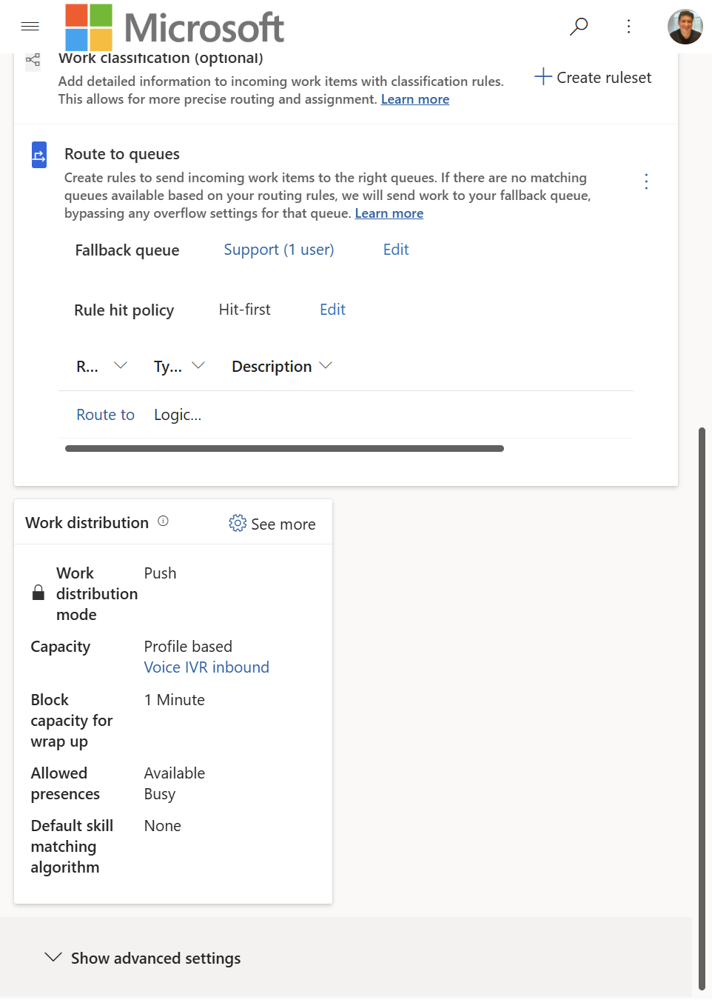
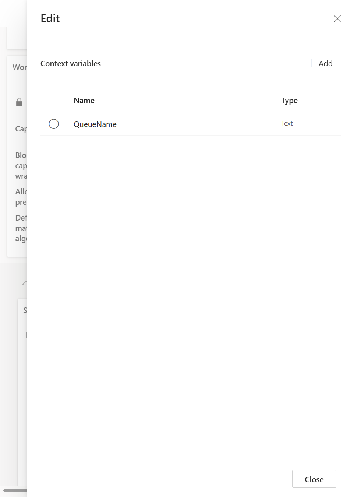
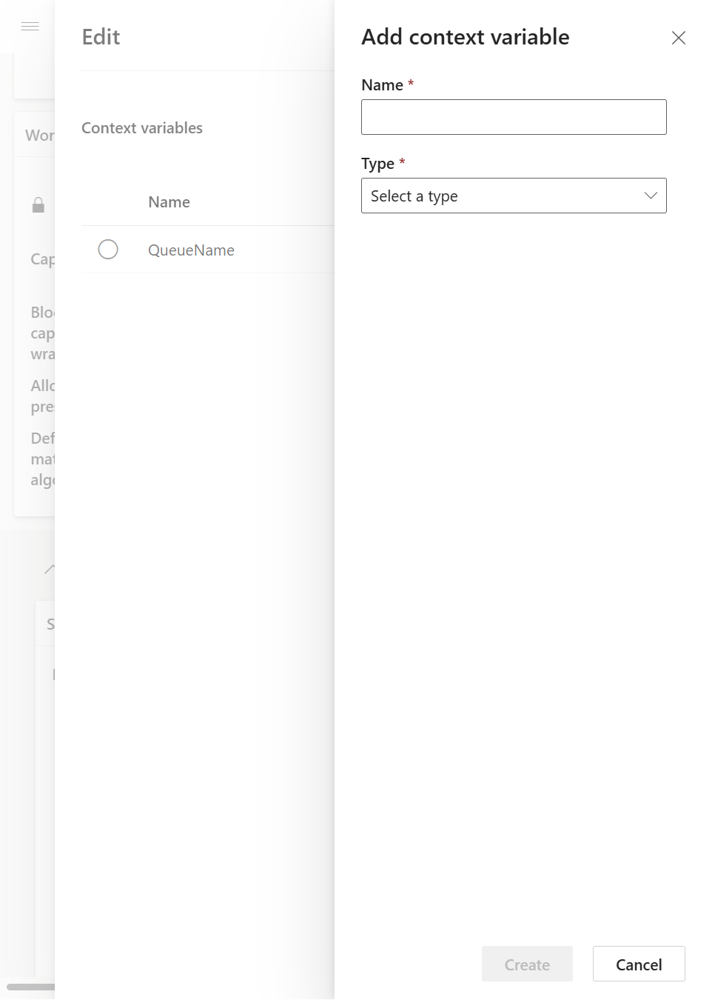
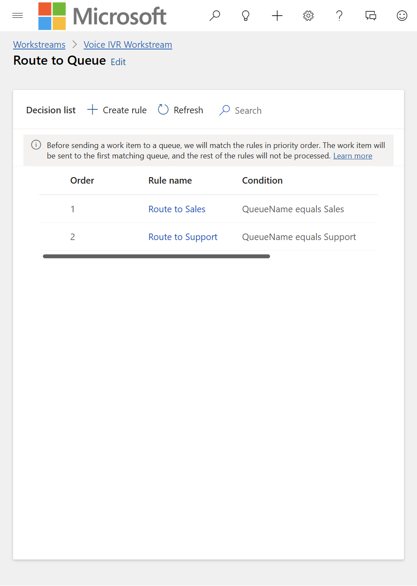

# Manual Dynamics 365 setup (no script)

[`scripts/Install-D365Setup.ps1`](../scripts/Install-D365Setup.ps1) does all of this for you. Use this guide if you cannot run scripts, if you want to understand each setting, or if you need to fix or extend one piece by hand.

Everything below is done in **Copilot Service admin center** (the Dynamics 365 app called *Admin center*). Steps marked **(verified)** were checked against the live admin center; where the screens have wording that can vary by release, the step says so.

The setup has six parts. The agent-to-Dynamics link is part 5 and part 6, and it is the one that most often goes wrong, so read the explanation first.

---

## How the agent and Dynamics 365 connect (read this first)

The IVR agent chooses the queue name; Dynamics 365 turns that name into a queue. Three things must line up **exactly** (spelling and capital letters):

| In Copilot Studio (agent) | Travels as | In Dynamics 365 (workstream) |
|---|---|---|
| `Global.QueueName` set to the text `Sales` or `Support` in **Main Menu** | Context passed by the **Transfer conversation** node (Context: Automatic) | Context variable named **`QueueName`** |
| | | Routing rule: **`QueueName` equals `Sales`** -> queue **Sales** |
| | | Routing rule: **`QueueName` equals `Support`** -> queue **Support** |

So you need: one **context variable** called `QueueName` (type **Text**) and **two routing rules**. Nothing else in the workstream refers to the agent's variables.

---

## 1. Operating hours (one per queue)

1. Copilot Service admin center > **Operations > Calendars** > **Operating hours** > **Manage** > **New**.
2. Name it `Sales Hours (08:00-12:00)` and **Save**.
3. On the **Working hours** tab choose **New > Working hours** and set:
   - **All day**: No
   - **Time**: 08:00 AM to 12:00 PM
   - **Repeat**: weekly on Monday to Friday
   - **Time zone**: your time zone (daylight saving is handled)
4. **Save**. Repeat for Support with `12:00 PM` to `6:00 PM`.
5. Optional: add holidays with **New > Holiday**.

## 2. Queues (Sales and Support)

1. **Customer support > Queues** > **Advanced queues > Manage** > **New**.
2. Name `Sales`, **Type: Voice**. Save.
3. Open the **Operation hours** tab > **Set operation hours** and choose `Sales Hours`. Save.
4. Repeat for `Support` with `Support Hours`.

The queue names must be exactly `Sales` and `Support`, because the agent looks the queues up by name.

## 3. Capacity profile (voice needs exactly one call)

A voice workstream must use a capacity profile whose **work item limit is exactly 1**. If you already have a profile with a limit of 1 (the shipped *Default voice inbound* normally is), use it. If its limit was changed, create a new profile with a limit of **1** and select that one in part 4. Otherwise saving the work distribution panel fails with *"Voice workstreams require a capacity profile with work item limit set to exactly 1"*.

## 4. The voice workstream

1. **Customer support > Workstreams** > **New**. Choose the **Voice** channel and **Push** distribution. Name it `Voice IVR Workstream`. Set the **fallback queue** to **Support**.
2. **Work distribution > See more**: **Capacity: Profile based**, pick the 1-call profile from part 3, wrap-up 1 minute, allowed presences **Available** and **Busy**. **Save and close**.
3. **Copilot agent**: add **Sales and Support IVR** to the workstream. Because an agent is attached, it answers first.
4. **Voice channel**: add your **phone number** here (the package never includes a number).

## 5. The context variable `QueueName` (verified)

1. Open the workstream and select **Show advanced settings** at the bottom.
2. In the **Context variables** card choose **Edit**.

   

3. Choose **+ Add**. Enter **Name** `QueueName` and **Type** `Text`, then **Create**.

   

4. **Close**. The card now lists `QueueName` with type `Text`.

> The name is case sensitive and must be `QueueName`, matching what the agent sends. Add the variable **before** creating the rules, because the rule condition picks it from this list. Allow about 20 seconds for it to become available to the routing rules.

## 6. The routing rules (verified list; editor wording may vary)

1. In the workstream, find **Routing rules > Route to queues**. A **Route to Queue** ruleset exists by default; open it (select its name).
2. Set **Rule hit policy** to **Hit-first** (shown as *Hit-first* on the workstream page) so the first matching rule wins.
3. Choose **Create rule** and make two rules:

| Order | Rule name | Condition | Route to queue |
|---|---|---|---|
| 1 | `Route to Sales` | context variable **QueueName** *equals* `Sales` | **Sales** |
| 2 | `Route to Support` | context variable **QueueName** *equals* `Support` | **Support** |

   In the rule editor, build the condition by choosing the **QueueName** context variable (it is offered under the workstream's context variables), the operator **equals**, and the value `Sales` or `Support`. The exact grouping of labels in the editor can differ between releases; what matters is the result below.

4. Check the result. The **Decision list** must read exactly like this:

   

   If the **Condition** column does not say `QueueName equals Sales` and `QueueName equals Support`, fix the rule before testing.

5. Confirm the **fallback queue** on the workstream is **Support**. A call that matches no rule goes there.

### What if I cannot find the QueueName variable in the rule?

The rule editor only offers context variables that already exist on the workstream. Make sure part 5 is saved, wait a minute, refresh the page, and try again. If you still cannot build the condition in the editor, run the setup script: it writes the same rules directly (see [HOW-IT-WORKS.md, section 7.4](HOW-IT-WORKS.md#74-the-context-variable-and-the-routing-rules)), and you can then open them in this editor to edit.

---

## 7. Verify the whole chain

| Check | Where | Expected |
|---|---|---|
| Queues have hours | Queue > Operation hours | `Sales Hours` and `Support Hours` |
| Workstream validates | Workstream | No red validation messages; agent shown; phone number on the Voice channel |
| Context variable | Workstream > Advanced settings > Context variables | `QueueName`, `Text` |
| Rules | Route to Queue ruleset | `QueueName equals Sales` and `QueueName equals Support` |
| Agent published | Copilot Studio | Published; Telephony and Omnichannel channels on |
| End to end (no phone) | [`Test-IvrConversation.ps1`](../scripts/Test-IvrConversation.ps1) | Open queue prints `handoff.initiate ... QueueName=<queue>` |
| End to end (phone) | Call the number during each queue's hours | The call lands in the right queue in the Customer Service workspace |

If a transferred call lands in the wrong queue, see [TROUBLESHOOTING.md](TROUBLESHOOTING.md#the-call-is-transferred-but-lands-in-the-wrong-queue).
